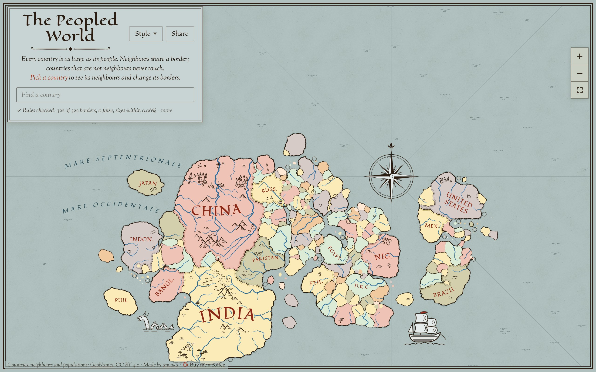

# The Peopled World

A fantasy world map drawn from one graph: the world's countries, linked when they share a land
border. The map keeps three rules:

1. Countries that are neighbours in the graph share a border.
2. Countries that are not neighbours never touch.
3. Every country's area is proportional to its population.

Nothing else comes from the real world. Where countries sit, their shapes and the coasts are made
up, so each world number gives a different map of the same graph.

[](https://anvaka.github.io/people-world/)

## Using the map

- Drag, pinch, scroll or double-click to move around; the buttons at the right edge zoom in, out
  and back to the whole world. Tap a country to see its neighbours. **Find a country** takes a
  name, the start of one or a two-letter code, and lists the countries that match as you type.
- **Change borders.** In a country's panel, **Remove** takes a border away and the field below (or
  "pick it on the map") adds one. The map is then redrawn starting from the world as it was, so the
  countries an edit doesn't touch stay where they were. While it is redrawn the old map stays in
  use, and a note at the bottom right says what is being drawn and can cancel it.
- **Show before** switches between the map before your changes and after; holding it (or the B
  key) shows the map before only while held. Each change in the list has its own Undo (Ctrl+Z
  undoes the last); undoing, and the browser's Back, are instant for the last few maps drawn.
- **Style** opens a menu: the map as Ink (a book's endpapers: pen, parchment, hatched coasts,
  mountains and woods) or Realm (a painted game world: terrain, shallows and rivers under the
  countries), and the theme: Light, Dark, or Auto (as the device is set). Switching doesn't build
  the world again, and the menu closes once the map is drawn in the new style. The browser
  remembers both choices.
- **Share a map.** The address holds the world number and the edits, so a link opens the same
  map. `#world-1-cut-FR-ES-add-JP-KR` is world 1 without the France–Spain border and with a
  Japan–South Korea one. Countries are named by their two-letter codes. Past four edits the link
  switches to a compact code of four letters or digits per edit (`#world-1-e-0PLu1pIL…`), so a
  long editing session still fits in a link you can paste. A style other than Ink ends the link
  (`#world-1-cut-FR-ES-realm`). **Share** copies the link, or opens a phone's share sheet.
- Keys: `/` finds, arrows move the map, `+` `−` zoom, `0` shows the whole world, Enter picks the
  country under the ring in the middle, B shows before, Ctrl+Z undoes, Escape closes.

A world takes about 5 seconds to build on a laptop, longer on a phone; an edit about 4. A link with
edits first builds the world without them, so it takes about twice as long.

## A graph of your own

Nothing among the page's controls says so, but a DOT file (Graphviz's `.dot` or `.gv`) dropped
anywhere on the page is drawn in the countries' place: every node a country, every link a border.

- **Sizes.** A node is as large as its `population`, `size`, `weight`, `value`, `count` or `area`
  attribute: the first of these that most nodes carry as a number and that tells them apart.
  Failing those, its `width` × `height` when the file sets them by hand (a file that has been
  through a Graphviz layout has them from the length of the labels, and they are passed over).
  Failing that, its PageRank, with every link read both ways and a link's `weight` counted.
- **Names and groups.** A node's `label` is its name. The cluster it sits in
  (`subgraph cluster_…`), or its `group` attribute, stands where a country's continent does.
- **What comes out.** Graphs near to flat keep all three rules: trees, grids, road-like and small
  social graphs. Zachary's karate club (34 nodes, 78 links) takes about 4 seconds; the characters
  of Les Misérables (77 nodes, 254 links) 15 to 20, with a hundred exclaves. A node with dozens of
  links, or a graph with many more links than a flat map can hold, comes out with a rule broken
  (usually sizes: the hubs are too small), and the line under the title says which. At most 500
  nodes; a graph that is still being drawn after three minutes is given up.
- **The address** names the graph by a key made from the file's text (`#graph-1a9qplw-world-1`),
  and the browser tab keeps the text, so reloading, Back and Forward, other world numbers and
  border edits work as they do for the countries. The file is not in the link: opened anywhere
  else, the link shows the countries and says why, so such a map has no Share button.

`window.peopledMap.openDot(text, name)` does the same from the console.

## Running it

It is a static page with no build step and no dependencies. Serve the folder with any file server,
for example:

```
python3 -m http.server 8080
```

and open http://localhost:8080. (Opening `index.html` straight from disk does not work: the page
loads ES modules and a module worker.) The same works on GitHub Pages.

The page counts its visits with Google Analytics: the tag is the `gtag` script in the head of
`index.html`. Take those lines out of a copy you publish yourself, or put your own ID there.

## Previews

GitHub Actions publish `main` to the `gh-pages` branch, which GitHub Pages serves. Every pull
request from a branch of this repository is published next to it, at
`https://anvaka.github.io/people-world/pr-preview/pr-<number>/`, and a comment on the pull request
links to it with a QR code, so a change can be tried on a phone before it is merged. Pushing to the
branch updates the preview; closing or merging the pull request removes it. Pull requests from
forks get no preview.

## How a world is made

1. **Layout.** Each country is a disc of its size. Neighbours are pulled together and other
   countries pushed apart: stress majorization on graph distances, then constraint projection.
2. **Exclaves.** The graph is not planar: it can't be drawn flat with every link as a border.
   `planar.js` finds the fewest links it can that have to go. Each of those becomes an exclave, a
   detached piece of one country that touches the other (Kaliningrad-style).
3. **Mesh.** About 50,000 cells: jittered quadtree points, finer where small countries sit, and
   the dual of their Delaunay triangulation.
4. **Growth and annealing.** Countries grow from their discs at a speed set by their size, then
   Metropolis annealing makes them compact. Hard rules hold at every step: a cell may touch a cell
   of another country only if the two are neighbours, a country stays in one piece, and a border
   never shrinks below a minimum length.
5. **Repairs.** Missing borders are bridged, long arms and ribbons are cut back, long water
   channels between countries that must not touch are widened into seas, and exclaves are carved.
6. **Geometry.** Cell boundaries become smooth, slightly rough hand-drawn lines. Areas are then
   fitted exactly, and the tiniest countries shrink to their true size.
7. **Islands.** Countries with no neighbours are blobs of exact area, placed in archipelagos off
   the coast of their continent. A small piece of land of its own (two countries that share an
   island and no other border, as Britain and Ireland do) is laid out like the large ones and
   put in the open water nearest the middle of its continent.
8. **Terrain.** Mountains and rivers belong to the world, not to the style it is drawn in
   (`terrain.js`). The ground rises inland, rough, with every border on a low ridge. Rain run off
   it finds the rivers and the land each drains; ranges stand on the divides between the larger
   ones, on their highest stretches, and along some long borders. Rain run off the ground with
   its ranges, more of it on the heights, gives the rivers, each drawn from its source down. So
   a river rises in the mountains or runs along their feet, keeps off the borders, and where it
   passes through a range the range is broken. Where two rivers meet, the larger runs on and the
   smaller ends on its line; no two cross.
9. **Valleys.** Each river gets the valley it would have cut (`valleys.js`): wider and deeper the
   more water it carries. Nothing is worn down grain by grain; a style that shows relief lowers
   the ground by the valley's depth, so its rivers lie in the land and not on it.
10. **Climate.** The south is warm, the north cold, the heights colder (`climate.js`). The winds
    blow in three belts, as on the Earth: trades in the south, westerlies in the middle,
    easterlies in the far north (half the worlds turn the other way). They carry the sea's
    moisture inland. The coast the wind reaches first is the wettest and the heart of a continent
    is dry; a range takes the rain on its windward side and leaves a rain shadow in its lee.
    Where two belts meet the air is still and dry, and there lie the deserts. A river waters its
    banks whatever the sky does. Warmth and moisture give what grows (Whittaker's table): tundra,
    taiga, steppe, grassland, forest, scrub, desert, savanna, jungle, with woods in patches and
    marshes on low wet ground near the sea.

**Addons.** Steps 8 to 10 are addons (`addons.js`). Each adds one part to what the generator
returns (`terrain`, `valleys`, `climate`), on one grid over the world's land (`land.js`). Each is on
unless it is turned off: `buildWorld(graph, {addons: {climate: false}})` in code, or
`?without=climate,valleys` in the page's address. The styles draw without a part that is missing:
no mountains or rivers without the terrain, rivers that lie flat without the valleys, and woods of
each style's own invention without the climate. A new addon is a module with a function
`(world, seed)` that returns its part, and a line in the list in `addons.js`.

**Edited maps** start from the world without edits. Countries start where they were, with a weak
pull back to that spot. The earlier exclaves are kept, and only the edited links get a new
decision. The mesh and every random choice are tied to positions on the map, not to the order in
which the work happens, so places an edit doesn't reach come out much the same. Some borders still
shift a little everywhere. An edit too big for this, such as a border across an ocean, breaks a
rule or takes too long; the page then draws the edited graph from scratch and says that countries
moved.

## Styles

Each style is three files in `styles/`: `<name>.css`, with every rule under
`html[data-style="<name>"]`; `<name>.js`, a module that registers `window.mapStyles[<name>]`; and
`<name>.fonts`, the Google Fonts address it needs. Only the chosen style loads with the page; the
others load the first time they are picked. The page calls a style's hooks: `render(world)` once
for each world drawn, `view(world, state, selected)` after each redraw, `settled(world)` before it
calls the map ready, and `unmount()` when another style is picked. A style's canvases sit in
`#plate` with the map, so a gesture moves them together. The comment above `skin()` in
`index.html` lists the hooks.

Switching styles draws the worlds on hand (and the map before your edits, when there is one)
again from what the generator returned, at the same view and with the same country picked. The
mountains and rivers are part of what it returned (`result.terrain`), and so are the valleys
(`result.valleys`) and the woods, deserts and marshes (`result.climate`): every style shows the
same ones. A style chooses how to draw them (firs, round crowns or flat-topped trees by the
warmth, dunes, reeds, the colour of the ground) and adds only its own hills and grain.

The heavy work of each style runs off the page's thread: Ink draws its terrain and seas in a
worker, in tiles kept per zoom level (one worker on a phone, two elsewhere); Realm prepares its
terrain in a worker and paints it with WebGL 2. On a software renderer (no GPU) Realm keeps its flat colours, which is what headless
test browsers show; `?realm-gl` in the address paints anyway.

## What makes it fast

- The generator: a faster `Math.hypot`, grids and bucket queues instead of searches over
  everything, typed arrays, and an area fit that leaves alone countries already within tolerance.
  World 1 went from about 13 to about 5 seconds, an edit from about 12 to about 4.
- Drawing a world is cut into slices of about 12 ms, so a phone keeps answering while it happens;
  the outlines, name positions and simplified lines are worked out once per world and kept.
- During a pan, pinch or wheel turn the picture already drawn (`#plate`) is moved as one bitmap
  and drawn properly when the gesture rests. Only lines on screen get a new level of detail.
- Lines, ripples and rings don't answer the pointer, so taps and hovers don't hit-test them.

## Checking the rules

```
node tools/check.mjs                               # worlds 1, 2 and 3
node tools/check.mjs 1 --edits cut-FR-ES-add-JP-KR # world 1, then world 1 with those edits
```

builds the worlds in Node (tested with Node 22) and checks all three rules on each, with areas
within 1% of their share of the population. It exits with 1 when a rule fails.
`node tools/check.mjs --dot graph.dot` does the same for a graph of your own.

## Known flaws

- Some worlds have long, thin water channels where wide seas would look better.
- In the most crowded regions (the Balkans, the Caucasus, Central Africa) a few countries come out
  stretched, and most worlds have 9 to 16 exclaves.
- An edit reshapes many countries, not only the ones edited: the warm start is not local.
- The land is not eroded: a valley is drawn from its river's flow, and there are no lakes.
- The climate has no seasons, and its belts lie at much the same latitudes in every world: the
  deserts are always about a third of the way up the map.
- On a phone held upright the whole world is a band across the middle of the screen: it is about
  twice as wide as it is tall.
- At whole-world zoom many countries are smaller than a pixel. That is rule 3: populations range
  from a few dozen people to 1.4 billion. A small ring marks each country too small to see.

## Files

| file | what it does |
| --- | --- |
| `index.html` | the page: drawing, pan and zoom, border editing, the style picker |
| `styles/` | the two styles: `ink` and `realm` (`.css`, `.js`, `.fonts` and helpers) |
| `worker.js` | runs the generator off the main thread |
| `dot.js` | reads a DOT file into a graph the generator draws; loaded when a file is dropped |
| `world.js` | the pipeline, `buildWorld(graph, {seed, base, addons})` |
| `layout.js` | country discs: stress majorization and constraint projection |
| `planar.js` | planarity test and the fewest-removal planar subgraph |
| `mesh.js` | the cell mesh |
| `label.js` | which country each cell belongs to: growth, annealing, repairs |
| `geom.js` | boundary lines from the cells |
| `process.js` | smoothing, roughening, exact area fitting |
| `islands.js` | island countries |
| `addons.js` | the list of addons run once the countries are drawn, each of which can be turned off |
| `land.js` | the grid the addons share: which country each cell is in, how far it is from the sea |
| `terrain.js` | addon: the mountains and rivers of a world |
| `valleys.js` | addon: the valleys its rivers have cut |
| `climate.js` | addon: warmth, winds, rain and what grows where |
| `util.js` | seeded random numbers, noise, polygon helpers |
| `countries.json` | the graph |
| `vendor/` | Delaunator, the `orient2d` predicate from robust-predicates, earcut (Realm's triangles) |
| `tools/check.mjs` | builds worlds and checks the rules |

## Credits

- Countries, populations and land neighbours: [GeoNames](https://www.geonames.org/)
  ([countryInfo.txt](https://download.geonames.org/export/dump/countryInfo.txt)), CC BY 4.0.
  Left out of that list: Serbia and Montenegro and the Netherlands Antilles, which no longer
  exist and are listed beside the countries that followed them, and the border of Serbia and
  Albania, which is Kosovo's (the list has Kosovo as a country of its own).
- [Delaunator](https://github.com/mapbox/delaunator) by Mapbox, ISC license.
- [robust-predicates](https://github.com/mourner/robust-predicates) by Vladimir Agafonkin, after
  Jonathan Shewchuk's predicates, public domain (Unlicense).
- [earcut](https://github.com/mapbox/earcut) by Mapbox, ISC license (`vendor/LICENSE-earcut`).
- Fonts from [Google Fonts](https://fonts.google.com/), SIL Open Font License: Eagle Lake,
  Fondamento and Sorts Mill Goudy (Ink), Alegreya and Alegreya SC (Realm).

## Support

If you enjoy the map and would like to support the work:

- [Buy me a coffee on Ko-fi](https://ko-fi.com/anvaka), a one-time tip;
- or sponsor it on [GitHub Sponsors](https://github.com/sponsors/anvaka), one time or monthly.

The page carries the Ko-fi link in its credit line and by the link to share, and both under "more".

## License

MIT, see [LICENSE](LICENSE).
